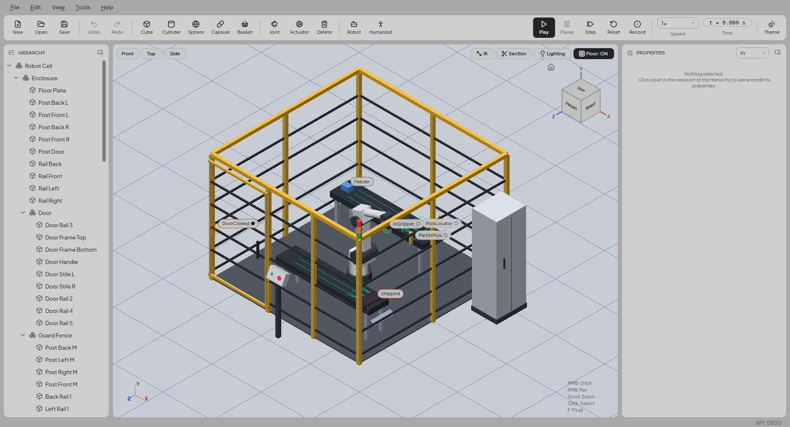
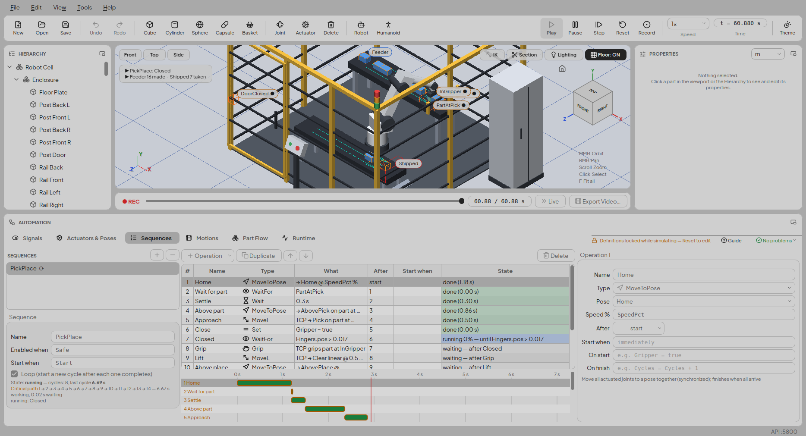
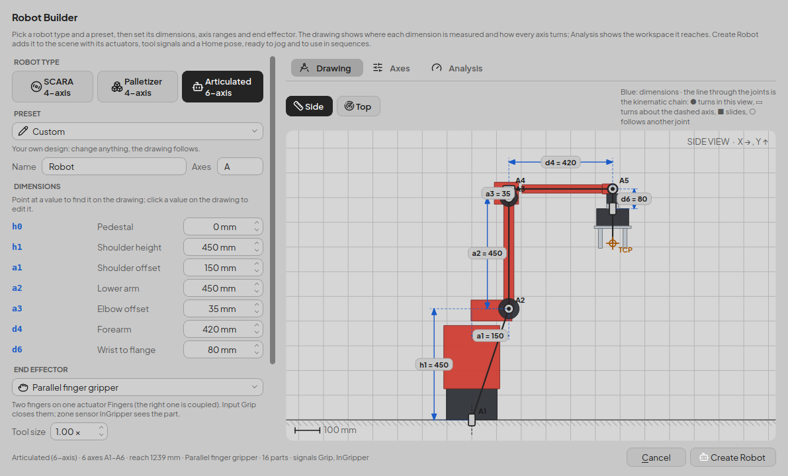

<p align="center">
  
</p>

<h1 align="center">MotionStudio</h1>

<p align="center">
  A desktop app for building digital twins of machines — robots, conveyors, stations — and running them: signal-driven sequences, sensors, part flow and MuJoCo physics, controllable from Python, C++ and Kotlin.
</p>

<p align="center">
  <a href="https://pypi.org/project/motionstudio-api/"></a>
  <a href="https://central.sonatype.com/artifact/io.github.zahid4kh/motionstudio"></a>
  <a href="https://github.com/zahid4kh/motionstudio/releases/tag/v0.3.0"></a>
  <a href="https://zahid4kh.github.io/motionstudio/"></a>
  <a href="LICENSE"></a>
</p>

<p align="center">
  <a href="https://buymeacoffee.com/zahidkh"></a>
</p>

---

<p align="center">
  
</p>

MotionStudio lets you build a machine out of primitive bodies or imported CAD parts, add revolute and prismatic joints and actuators, and program how it moves with signals, expressions and operation sequences. Press Play and the logic runs as a PLC-style scan: parts are fed in, sensors see them, robots pick them up and belts carry them away. A program, or a real PLC over Modbus TCP, can drive the same model from outside.

It targets the workflow of a mechanical or automation engineer trying out how a machine moves before it exists: conveyors, robot arms, linear axes, pick-and-place cells, whole stations from STEP.

<p align="center">
  
</p>

## Features

### Modelling

- **3D editor** — orbit camera, ortho/perspective, view cube, translate gizmo, hierarchy with drag & drop and grouping, properties inspector, undo/redo of every edit
- **STEP import** — CAD assemblies (`.step`/`.stp`) via OpenCASCADE, keeping the part tree; multi-body parts are split into their solids, Z-up models stood upright
- **Joints and actuators** — revolute (optionally continuous) and prismatic, axes picked on the model's faces and edges, coupled joints, position or speed control with trapezoidal profiles
- **Assembly tools** — mates (flush, concentric, insert …), measure, section view, hide and see-through parts
- **Component library** — drop-in belts, sensors, a gantry, a turntable, a gripper, bins
- **URDF / MJCF** — import robot descriptions and export a scene to either

### Automation

- **Signals** — inputs, internal flags, derived formulas and sensors (light beam, zone, distance, position)
- **Sequences** — operations with predecessors, parallel branches, start conditions and actions: moves, taught poses, straight-line MoveL, grip/release, waits, walking
- **Part flow** — sources feed copies of a part, sinks take them away
- **Runtime** — buttons, watch list, signal trace, operation status, Gantt timing with the critical path, interference check
- **Recording** — scrub back through a run and export it as MP4 or GIF
- **Modbus TCP server** — connect a real or soft PLC to the twin's signals

### Physics

- **MuJoCo** — opt in per object for gravity, collisions and contact; conveyor belts move parts by surface velocity, actuated joints follow the automation exactly

### Robots

- **Robot Builder & Analyzer** — SCARA, palletizer or 6-axis from 28 presets and your own dimensions, 16 end effectors, a live dimensioned drawing; workspace, reach, DH parameters, dexterity and singularities of any robot
- **Humanoids** — build one from 7 presets; it walks ahead, sideways, turning, to a marker or along a path; record motions and train a small model on them

<p align="center">
  
</p>

## Robot API

Programs drive a running MotionStudio over TCP (**Tools › Robot API**, port 5800), or run headless with `motionstudio-server`: move robots in joint moves and straight lines, go to taught poses, walk humanoids, read and write signals, wait for conditions, and **build whole scenes from code** — import CAD, add joints, belts, physics, sensors, sequences and part flow, then save.

| Language | Get it | Docs |
| --- | --- | --- |
| Python 3.8+ | `pip install motionstudio-api` (imported as `motionstudio`) | [api/python](api/python/README.md) |
| Kotlin / JVM 17+ | `implementation("io.github.zahid4kh:motionstudio:0.3.0")` | [API reference](https://zahid4kh.github.io/motionstudio/) · [api/kotlin](api/kotlin/README.md) |
| C++17 | CMake FetchContent from the [v0.3.0 release](https://github.com/zahid4kh/motionstudio/releases/tag/v0.3.0) | [api/cpp](api/cpp/README.md) |

```python
import motionstudio

with motionstudio.connect() as studio:      # localhost:5800
    robot = studio.robot("Robot")         # by name, or robot() if there is only one
    start = robot.pose()
    robot.move_l(start.offset(y=-150))      # 150 mm lower, in a straight line
    robot.move_by(x=200, speed=200)
    robot.home()
```

The wire protocol (one JSON object per line) is in [api/PROTOCOL.md](api/PROTOCOL.md), so any language with sockets can talk to it. [api/python/examples/sorting_station.py](api/python/examples/sorting_station.py) rebuilds a whole sorting station from a STEP file through the API.

## Building

Requirements:

- CMake ≥ 3.20, a C++20 compiler
- Qt 6 (Core, Gui, Widgets, OpenGL, OpenGLWidgets, Concurrent, Network, Xml)
- [MuJoCo 3.10.0](https://github.com/google-deepmind/mujoco/releases) extracted to `~/mujoco-3.10.0` (optional — without it the simulation is kinematic only)
- OpenCASCADE (optional — enables STEP import): `libocct-data-exchange-dev`, `libocct-ocaf-dev`, `libocct-modeling-algorithms-dev`

```bash
# Build and run
./run.sh

# Manual build
cmake -B build -DCMAKE_BUILD_TYPE=Release
cmake --build build -j$(nproc)

# Run (MuJoCo must be on LD_LIBRARY_PATH)
LD_LIBRARY_PATH=~/mujoco-3.10.0/lib ./build/MotionStudio

# Headless server for the Robot API
LD_LIBRARY_PATH=~/mujoco-3.10.0/lib ./build/motionstudio-server templates/robot_cell.mstudio
```

Override the MuJoCo location with `-DMUJOCO_ROOT=<path>` or the `MUJOCO_ROOT` env var. MuJoCo and OpenCASCADE are detected at build time; the features that need them compile out when they are missing.

## Quick start

The fastest way in is a template: **File › Open Template…**, pick one (the 6-axis robot cell, a sensor & gripper cell, a part flow cell, a humanoid patrol, an indexing table, a pick & place arm, a pendulum, a solar system …), press **Play**, and switch **Start** ON in **Automation › Runtime** (Ctrl+J opens the panel).

To build one yourself — objects added while something is selected become its children, and joints connect a parent to a child:

1. `+ Cube` → Base; select Base → `+ Cylinder` → Arm1; select Arm1 → `+ Cylinder` → Arm2 (lift each with Position Y)
2. Select Arm1 → `Add Joint` → `Add Actuator` (**J1**); select Arm2 → `Add Joint` → `Add Actuator` (**J2**)
3. **Automation › Signals** → `+ Input` → `Start`
4. **Automation › Sequences** → `+`, set *Start when* = `Start`, tick *Loop*
5. `+ Operation › Move` J1 → `60`, then `Move` J2 → `-45`, then `Move` J1 → `0`
6. `▶ Play`, then switch **Start** ON in **Automation › Runtime**

The in-app guide (**Help**, F1) covers every panel and operation; [USAGE.md](USAGE.md) has the toolbar reference, camera controls and a joint axis cheat sheet.

## Architecture

`MainWindow` owns a shared `SceneGraph`, the single source of truth for all scene data including the automation definitions, and wires it up to:

- a `Viewport` (OpenGL 3.3 renderer)
- a `SimulationEngine`, which runs the `AutomationEngine` scan cycle and adds MuJoCo physics when rigid bodies are present
- `HierarchyPanel`, `PropertiesPanel` and `AutomationPanel` (the Qt UI)
- an `UndoManager` (whole-scene snapshot undo/redo)
- an `ApiServer` (the Robot API) and a `ModbusServer`

Everything without widgets or OpenGL builds as the static library `MotionStudioCore`, shared by the app, `motionstudio-server` and the tests. Projects round-trip to `.mstudio` JSON files via `ProjectSerializer`.

Tests: `cmake -B build -DMOTIONSTUDIO_TESTS=ON`, then `./build/MotionStudioTests` (headless engine tests); each API library has live tests against `motionstudio-server`.

## Status

MotionStudio is an actively developed hobby project, not production software. Expect rough edges.

Development is AI-assisted, with features planned and reviewed deliberately rather than churned out — the goal is a tool that's actually coherent to use, not just one that accumulates checkboxes.

## License

[MIT](LICENSE)
